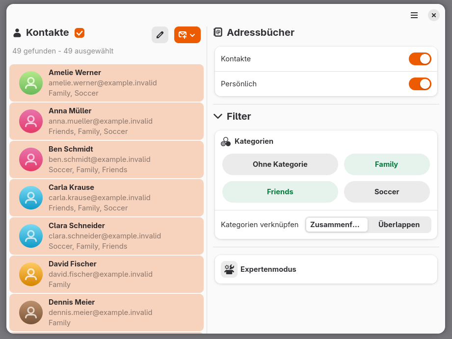

# Categories


**Categories** is a graphical application for GNOME/Linux that allows contacts to be filtered and edited based on their vCard categories. It also provides a way to prepare emails addressed to filtered contacts.

The idea for this project arose from the desire to avoid maintaining separate email distribution lists for different applications. Such lists are often difficult to synchronize and require regular maintenance. In addition, organizing contacts in separate address books only allows for one-dimensional grouping.

The application accesses contact address books through the **Evolution Data Server (EDS)**. It is intended for users who already manage their contacts through GNOME, Evolution, or compatible address book sources and want to organize them using categories.

**Categories** is not intended to be a full address book. Therefore, no contact editing beyond vCard categories (`categories`) will be supported. Duplicate detection will not be provided either.

## Features

- **Display contacts:** Load contacts from available EDS address books and display them in alphabetical order.
- **Filter by categories:** Search and narrow down contacts based on their vCard categories.
- **Combine categories:** Combine multiple selected categories using OR and AND operations.
- **Advanced filters:** Create custom filter expressions using `AND`, `OR`, `NOT`, and parentheses.
- **Edit categories:** Add, remove, and create categories for selected contacts.
- **Save changes:** Write modified categories back to the respective address books.
- **Address emails:** Prepare or address emails to selected contacts.

## Requirements

Categories requires a Linux environment with the following components:

- Python 3
- GTK 4
- libadwaita
- PyGObject (`gi`)
- Evolution Data Server, including its Python introspection bindings
- Configured and accessible contact address books in Evolution Data Server

The availability of the required packages depends on the Linux distribution being used.

## Installation and startup

Categories is currently run directly from its source code. A cross-distribution installation package is not yet available.

### 1. Download the repository

Download the repository from GitHub and extract it. Alternatively, clone the repository using Git:

```bash
git clone https://github.com/chcervus/Categories.git
cd Categories
```

### 2. Install dependencies

Install Python 3, GTK 4, libadwaita, PyGObject, and the required Evolution Data Server components using your distribution's package manager.

### 3. Run the application

Start the application from the project directory:

```bash
python3 categories_frontend.py
```

On Fedora, you can use the following command, for example:

```bash
/usr/bin/python3 categories_frontend.py
```

The application requires access to Evolution Data Server and the address books configured there.

## Project structure

- `categories-frontend.py` contains the graphical user interface and application logic.
- `kontakt_backend.py` contains the functions for accessing contacts and categories, as well as filter evaluation.
- `data/icons/` contains the application icon used for GNOME integration.

## License

Categories is released under the **GNU General Public License v3.0 or later (GPL-3.0-or-later)**.

The full license text is available in the `LICENSE` file.

## Development status

Categories is under active development. The application is initially being released as source code. Installation and execution currently need to be performed manually.

**Bug reports, suggestions for improvements, and contributions are welcome.** The project is currently in the **testing phase**.

### To do:

- [ ] Improve the user interface: better arrange filter and selection information
- [ ] Add icons
- [ ] Fix hover effect (rectangles appear)
- [ ] Test saving issues
- [ ] Set up a language pack

### Note on AI

The application was developed with the assistance of LLMs. I use them as tools for programming.

The assistance particularly included:

- Explanations of Python, GTK, and Evolution Data Server (EDS)
- Assistance with debugging
- Improving and extending the filter logic
- Assistance with the design of the saving process, particularly version checks, background threads, and feedback to the GTK interface
- Considerations regarding error handling and the protection of personal contact data

The suggestions were reviewed in the context of the existing code and gradually adopted or adapted.

The ideas, design, and structure of the project remain my responsibility.